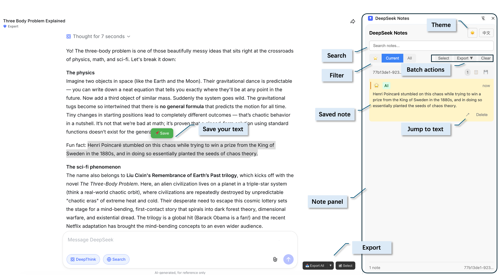

<div align="center">

# 📌 DS Note

**让 DeepSeek 的对话真正属于你**

[](LICENSE)
[](https://github.com/RuanNYin/ds-note)
[](https://github.com/RuanNYin/ds-note)

</div>

---



## 👋 这是什么

和 DeepSeek 聊得越久，对话越长，想找回来的那句话就越难翻。

DS Note 就是为这个场景做的：**摘录关键内容**、**整条保存**、**导出对话**，并且能一键跳回原文对应的位置。

> 本项目基于 [chenxiachan/ds-note](https://github.com/chenxiachan/ds-note) 继续维护，在其之上补齐了附件支持、导出打包和一批可用性修复。

## ✨ 功能

| | 功能 | 说明 |
|---|------|------|
| 📌 | **保存整条消息** | 每条消息右下角的 📌 按钮，用户消息和 AI 回复都能存 |
| 📋 | **选中即复制** | 选中文字 → 悬浮条里可保存，或复制为 Markdown（保留 LaTeX）|
| 🔘 | **选中弹窗开关** | 觉得悬浮条碍事可以在侧栏一键关掉 |
| ↗️ | **跳回原文** | 点击笔记跳回原消息，并精确高亮当初选中的那段文字 |
| 🕐 | **长对话定位** | 基于时间线的滚动定位，长会话也能准确跳转 |
| 🔍 | **搜索与筛选** | 搜索笔记内容，按会话 / 星标筛选 |
| 🗂️ | **会话分组** | 笔记按会话归档，可收起/展开，显示会话标题 |
| 📤 | **导出对话** | Markdown / JSONL / **ZIP（带附件）**，页面内与侧栏都能导 |
| 📎 | **附件支持** | 图片和文件（pdf/ppt/html…）可随对话一起导出，ZIP 里是真文件 |
| 📥 | **回灌到新会话** | 把当前对话的全文 + 附件重新上传到一个新对话，长会话可「搬家」|
| 🌓 | **主题** | 深色 / 浅色 |
| 🌐 | **双语** | 中文 / English 界面 |

## 📦 安装

适用于 **Edge / Chrome 等 Chromium 内核浏览器**（Firefox 不支持，见下方说明）。

1. 下载并解压本仓库
2. 打开 `edge://extensions`（Chrome 是 `chrome://extensions`）
3. 打开右上角 **开发人员模式**
4. 点 **加载解压缩的扩展**，选择仓库根目录
5. 打开 [chat.deepseek.com](https://chat.deepseek.com)

> 更新代码后，**必须回到扩展页点一次「重新加载」并刷新 DeepSeek 页面**。否则浏览器会继续运行旧的 service worker / 旧的内容脚本，看到的行为和代码不一致——这是排查问题时最常见的坑。

## 🚀 用法

1. **保存整条消息**：鼠标移到消息上，点右下角的 📌
2. **保存选中的一段**：选中文字 → 悬浮条点 📌（保存）或 📋（复制为 Markdown）
3. **查看笔记**：点浏览器工具栏的扩展图标，打开侧边栏
4. **跳回原文**：笔记上的 ↗️
5. **导出**：页面右下角工具条（导出全部 / 已选），或侧栏的「导出」
6. **回灌**：页面右下角的 📥 回灌 —— 见下一节

## 📥 回灌到新会话

一个会话聊得太长、DS 开始压缩上下文，或者你想换个干净会话继续，点 **📥 回灌**：

1. 扩展先把整段对话扫一遍，收集正文和附件地址
2. 生成一份 `.md` 对话记录，并把每个附件重新下载下来
3. 自动点「开启新对话」，把 **对话记录 + 所有附件** 一起塞进输入框
4. 帮你填好一句引导语，**发送键留给你按**

几个要点：

- **为什么要重传附件**：导出的 md 里是签名链接，DS 自己的读取通路是匿名请求，拿不到内容（见「已知限制 1」）。所以只能把字节重新上传一遍。
- **上限**：DS 限制 **每个对话 50 个文件、单文件 100MB**。超出会被截断，被截掉的文件名会写在 md 开头。
- **图片**：上传的是预览 webp（服务端不给原图），不是原始 png。
- **它是「迁移检查点」，不是「记忆」**：新会话里的模型把这份记录当文档读，不会当成自己说过的话；每轮对话都会重新读一遍，token 成本是持续的。适合一次性搬家，不适合每轮都做。
- 回灌后不会自动发送，你可以先删掉不想要的文件、改引导语，再自己按发送。

## 📤 导出说明

### 格式

| 格式 | 内容 | 适用 |
|---|---|---|
| **MD** | 按「轮次」分组的 Markdown，附件为链接 | 阅读、丢给别的 AI |
| **JSONL** | 一行一条消息，带角色和时间 | 二次处理、喂脚本 |
| **ZIP** | 一个 `.md` + `assets/` 目录（附件真文件）| **长期归档、离线阅读** |

页面端的格式选择由下拉框统一控制，「导出全部」和「导出选中」共用同一个格式。

### 文件名

统一为「会话标题 + 时间」，例如 `上海华力单位性质解析 - DeepSeek-20261029-2134.md`。标题里的 `\ / : * ? " < > |` 等非法字符会被过滤。

### 附件

| 类型 | 拿到什么 | 说明 |
|---|---|---|
| **图片** | 大尺寸预览图（webp，约 160KB）| 原始 PNG 拿不到，服务端不开放原图接口 |
| **文件**（pdf / ppt / html / txt / md / 代码…）| **原始文件**，字节完全一致 | 已验证 pdf / pptx 的 SHA256 与原文件相同 |

- 扩展本身**不挑格式**：只要 DeepSeek 收下了这个文件，导出时就按原始字节打包。DeepSeek 上传框支持约 985 种扩展名（图片 62 种、文档 18 种、代码/配置 905 种）。
- ZIP 里的附件放在 `assets/`，md 里的链接会改写成包内的相对路径，**离线可读**。
- 拿不到地址的附件（不是当前打开的会话、或极老的历史附件）只保留文件名，不会丢内容。

## ⚠️ 已知限制与注意事项

**1. 导出 md 里的附件链接是「签名 URL」，只有你的浏览器能打开**

这些链接指向 `files.deepseeksvc.com`，带签名参数，并且和你的登录会话绑定。所以：

- ✅ 你在浏览器里点开 → 正常
- ❌ 把这个链接粘给 DeepSeek 网页让它读 → **读不到**（它走的是自己的抓取通路，属于匿名请求）
- ❌ 换一台机器 / 退出登录后再点 → 可能失效

如果需要把内容喂给 DeepSeek，请用 **ZIP 里解压出来的真文件**（直接拖进输入框），或者复制正文粘贴。

**2. VSCode 的 Markdown 预览会破坏附件链接**

VSCode 预览在打开链接前会做一次 URL 解码，把 `%2F` 还原成 `/`，签名就失效了（浏览器直接打开是正常的）。**在 VSCode 里请只看文字，附件用 ZIP 包里的本地文件。**

**3. 图片只有预览图，没有原图**

服务端对图片不开放「原图」接口（`ty=r` 会被拒绝），所以打包的是 160KB 左右的预览 webp，并把文件名自动改成 `.webp`。

**4. 旧笔记没有附件链接**

附件支持是后加的。**在这个版本之前保存的笔记里只有文件名**。补救办法：在侧边栏导出时，扩展会向当前打开的 DeepSeek 标签页重新取一次附件地址并补上链接；或者重新保存一次那条消息。

**5. 重新生成的多版本回复只导出当前那份**

DeepSeek 重新生成后会出现 `1/3 ‹ ›` 切换，同一提问下有多份候选回复。目前**只导出当前显示的那一份**，其余候选没有进导出。

**6. 超大附件未压测**

已验证 34KB 的 PDF/PPTX、160KB 的图片没问题；**几十 MB 的文件没有实测**。ZIP 通过扩展消息传递，理论上有体积上限，如果遇到失败会自动降级为普通 Markdown 导出并提示。

**7. Firefox 不支持**

只适配 Chromium 的 `sidePanel` API，Firefox 的 `sidebarAction` 是另一套接口。

**8. 回灌依赖 DeepSeek 的页面结构**

回灌用的是页面里的 `<input type=file>`、「开启新对话」按钮和输入框。DS 改版后这些可能失效——失效时扩展会报错并停下，不会发出半截消息。另外，回灌会把附件在服务器上再存一份。

## 🔒 隐私

- ✅ 笔记只存在本机浏览器的 `chrome.storage.local`
- ✅ 不上传任何数据到第三方服务器
- ✅ 仅在 `chat.deepseek.com` 上运行；附件下载只访问 DeepSeek 自己的文件服务

## 📁 项目结构

```
ds-note/
├── manifest.json        # 扩展配置（权限：storage / sidePanel / tabs / scripting）
├── background.js        # Service worker：存储、ZIP 打包、主世界读取附件元数据
├── content-script.js    # 保存、跳转高亮、导出、附件解析
├── sidepanel/           # 笔记面板 UI
└── styles/              # 注入样式
```

## 🛠 开发

纯静态扩展，**零依赖、零构建**，改完直接重载即可。

需要注意的实现细节（都踩过坑）：

- **虚拟列表**：DeepSeek 只渲染当前滚动窗口内的消息，附件元数据必须边滚动边累积，否则长会话前部的附件拿不到地址。
- **隔离世界**：内容脚本读不到页面挂在 DOM 节点上的 React 属性（`__reactFiber$…`），附件签名地址必须由 background 用 `chrome.scripting.executeScript({ world: 'MAIN' })` 在主世界读取。
- **附件下载参数**：`/api` + `signedPath` + `ty=<类型>`，`ty=r` 取原件（非图片）、`ty=p` 取大预览图（图片）、`ty=t` 缩略图。
- **回灌注入文件**：页面里的文件框可以直接赋 `DataTransfer`，再派发一个 `bubbles: true` 的 `change`，React 的 onChange 就会照常走上传流程（不需要模拟点击）。图片会渲染成缩略图而不是文件 chip，两者都要数。整个流程必须在 SPA 内完成——`location.href` 跳转会丢掉内存里的文件。

## 📄 License

[MIT](LICENSE)

---

<div align="center">

<sub>DS Note 与 DeepSeek 官方无关。DeepSeek 是深度求索的商标。</sub>

</div>
